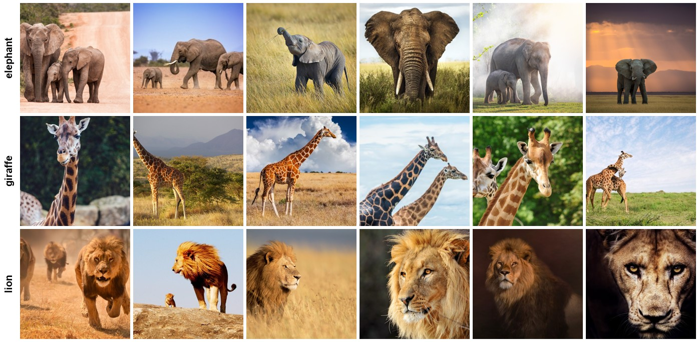
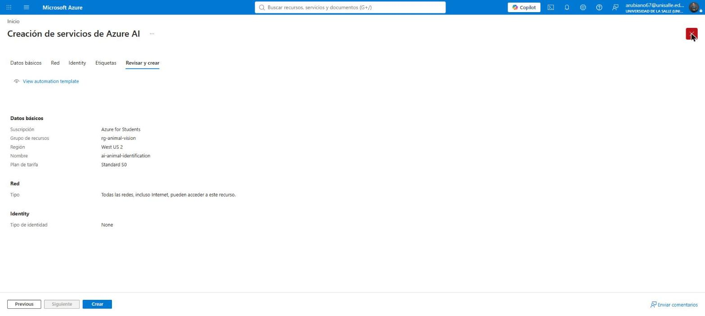
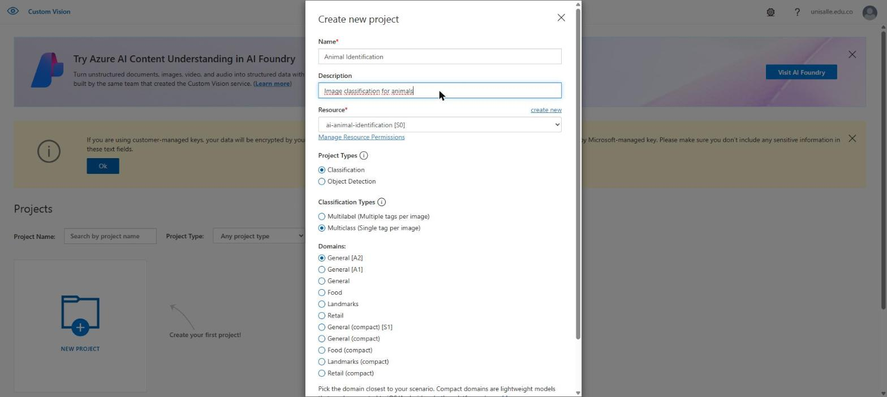
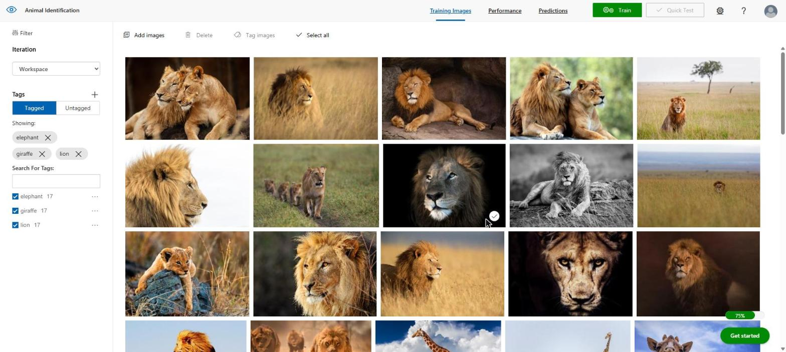
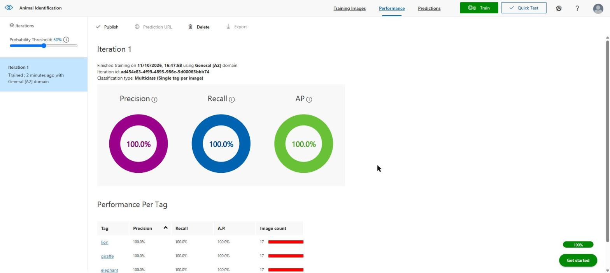
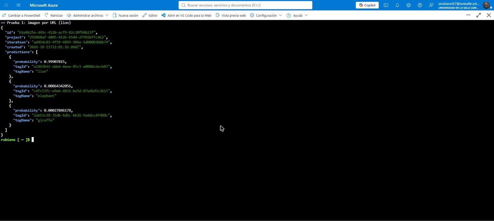

# Animal Identification · Azure AI Custom Vision

Clasificador de imágenes de animales (elefante, jirafa y león) construido con **Azure AI Custom Vision**, publicado como servicio y consumido desde **Azure Cloud Shell** con la API REST de predicción.

| Aspecto | Detalle |
|---|---|
| **Autor** | Andrés Giovanny Rubiano Muñoz "Andy Rubiano" · arubiano67@unisalle.edu.co |
| **Asignatura** | Visión por Computador · Maestría en Inteligencia Artificial · Universidad de La Salle |
| **Informe** | Repositorio [animal-identification-report](https://github.com/RubianoAndy/animal-identification-report) (LaTeX, formato IEEE) |
| **Año** | 2026 |

---

## Resultado

| Elemento | Valor |
|---|---|
| Recurso | `ai-animal-identification` · grupo `rg-animal-vision` · West US 2 · Standard S0 |
| Proyecto Custom Vision | *Animal Identification* · Classification · Multiclass · General [A2] |
| Dataset | 51 imágenes, 17 por clase |
| Entrenamiento | Quick Training · Iteration 1 · 6 min |
| Métricas (umbral 50 %) | Precision 100 % · Recall 100 % · AP 100 % |
| Quick Test con imágenes externas | elephant 97,6 % · giraffe 98,4 % · lion 99,9 % |
| Modelo publicado | `animal-classifier` |
| Cliente | Azure Cloud Shell (Bash) con `az`, `curl` y `jq` |

<div align="center">
    
    <br><em>Seis imágenes de entrenamiento por clase</em>
</div>

---

## Estructura

```
animal-identification/
├── dataset/
│   ├── elephant/      # 17 imágenes
│   ├── giraffe/       # 17 imágenes
│   ├── lion/          # 17 imágenes
│   └── test/          # 3 imágenes externas para pruebas + FUENTES.md
├── scripts/
│   └── predict_cloudshell.sh      # cliente de línea de comandos (Cloud Shell)
├── results/
│   ├── cloudshell_results.json    # resumen de las 3 predicciones desde la API
│   └── lion_prediction_response.json  # respuesta completa de la API para el león
├── screenshots/       # 41 capturas del proceso en Azure, numeradas
└── docs/
    ├── bitacora.md    # decisiones, IDs y métricas, en orden cronológico
    ├── dataset-samples.jpg
    └── test-samples.jpg
```

## Dataset

Las imágenes de entrenamiento provienen del laboratorio *Explore image classification* del curso AI-900 de Microsoft ([archivo `animals.zip`](https://github.com/MicrosoftLearning/AI-900-AIFundamentals/raw/main/data/vision/animals/animals.zip)). Las tres imágenes de prueba son de Wikimedia Commons y sus fuentes están en [`dataset/test/FUENTES.md`](dataset/test/FUENTES.md).

## Probar el modelo desde Cloud Shell

El script obtiene la clave del recurso con Azure CLI dentro de la sesión, de modo que nunca se escribe en pantalla ni en archivos. Requiere acceso al recurso `ai-animal-identification` en la suscripción.

```bash
bash scripts/predict_cloudshell.sh
```

Realiza tres llamadas: una por URL (león) y dos por archivo binario (elefante y jirafa). Las respuestas obtenidas están en [`results/`](results/).

| Imagen | Punto de conexión | Predicción | Probabilidad |
|---|---|---|---|
| León | `/url` | lion | 0,99908 |
| Elefante | `/image` | elephant | 0,97605 |
| Jirafa | `/image` | giraffe | 0,98417 |

## Proceso en imágenes

| Paso | Captura |
|---|---|
| Recurso de Azure AI Services validado |  |
| Proyecto de Custom Vision |  |
| Tres etiquetas con 17 imágenes |  |
| Métricas de la iteración |  |
| Respuesta de la API desde Cloud Shell |  |

## Seguridad

Ninguna clave del recurso está en este repositorio. En las capturas 16 y 37 la clave se cubrió antes de incluirlas.
