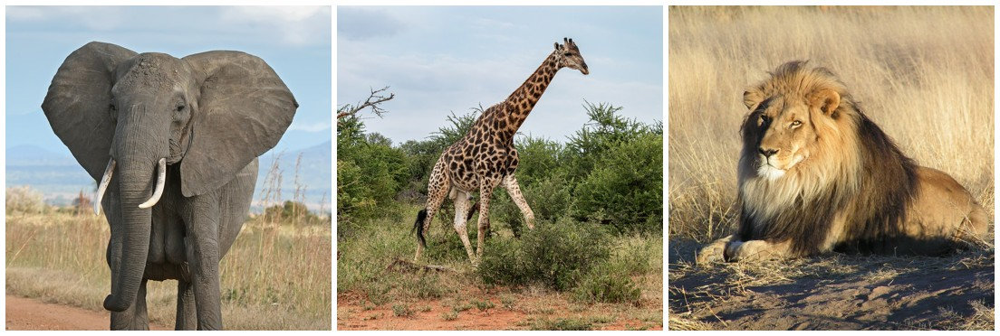

<div align="center">
    
</div>

# Animal Identification · Clasificador de imágenes de animales con Azure AI Custom Vision

## 📋 Información General

<div align="center">
    
</div>

| Aspecto | Detalles |
|--------|----------|
| **Autor** | Andrés Giovanny Rubiano Muñoz "Andy Rubiano" |
| **Correo** | arubiano67@unisalle.edu.co |
| **Asignatura** | Visión por Computador |
| **Docente** | Carlos Alejandro Espejo Villarraga |
| **Actividad** | Actividad 4 · Implementemos un modelo de clasificación de imágenes |
| **Programa** | Maestría en Inteligencia Artificial |
| **Universidad** | Universidad de La Salle |
| **Entregable** | Proyecto completo: dataset, cliente de línea de comandos, resultados de la API y capturas del proceso |
| **Informe** | [animal-identification-report](https://github.com/RubianoAndy/animal-identification-report) · informe IEEE en LaTeX |
| **Estado del recurso** | `rg-animal-vision` se mantiene activo durante la evaluación para que el modelo publicado pueda verificarse |
| **Año** | 2026 |

---

## 🎯 Descripción

Se recorre el ciclo completo de un clasificador de imágenes en la nube con **Azure AI Custom Vision**: creación del recurso de Azure AI Services sobre una suscripción *Azure for Students*, configuración del proyecto *Animal Identification* (clasificación multiclase, dominio General [A2]), carga y etiquetado de 51 imágenes en tres clases (`elephant`, `giraffe`, `lion`, 17 por clase), entrenamiento rápido, evaluación con las métricas del servicio y con imágenes externas, publicación del modelo `animal-classifier` y consumo de la API de predicción desde **Azure Cloud Shell**.

| Elemento | Valor |
|---|---|
| Suscripción | Azure for Students |
| Recurso | `ai-animal-identification` · grupo `rg-animal-vision` · West US 2 · Standard S0 |
| Proyecto | Animal Identification · `292060af-4805-412b-b544-df9926ffc462` |
| Iteración | Iteration 1 · Quick Training · General [A2] |
| Métricas (umbral 50 %) | Precision 100 % · Recall 100 % · AP 100 % |
| Quick Test externo | elephant 97,6 % · giraffe 98,4 % · lion 99,9 % |
| Modelo publicado | `animal-classifier` |
| Cliente | Azure Cloud Shell (Bash) con `az` + `curl` + `jq` |

> La región East US, elegida inicialmente, fue rechazada por la política de regiones de la suscripción de estudiante (`RequestDisallowedByAzure`); el recurso se creó en West US 2.

---

## 🧪 Proceso

### 1 · Recurso de Azure AI Services

<div align="center">
    
</div>

### 2 · Proyecto de Custom Vision

<div align="center">
    
</div>

### 3 · Dataset y etiquetado

Las imágenes de entrenamiento provienen del laboratorio *Explore image classification* del curso AI-900 de Microsoft ([`animals.zip`](https://github.com/MicrosoftLearning/AI-900-AIFundamentals/raw/main/data/vision/animals/animals.zip)). Las tres imágenes de prueba son de Wikimedia Commons y sus fuentes están en [`dataset/test/FUENTES.md`](dataset/test/FUENTES.md).

<div align="center">
    
    <br><br>
    
</div>

### 4 · Entrenamiento y evaluación

<div align="center">
    
    <br><br>
    
</div>

### 5 · Publicación y cliente en Cloud Shell

El script [`scripts/predict_cloudshell.sh`](scripts/predict_cloudshell.sh) obtiene la clave del recurso con Azure CLI dentro de la sesión, de modo que nunca se escribe en pantalla ni en archivos, y realiza tres llamadas a la API de predicción: una por URL (león) y dos por archivo binario (elefante y jirafa).

```bash
bash scripts/predict_cloudshell.sh
```

| Imagen | Punto de conexión | Predicción | Probabilidad |
|---|---|---|---|
| León | `/url` | lion | 0,99908 |
| Elefante | `/image` | elephant | 0,97605 |
| Jirafa | `/image` | giraffe | 0,98417 |

<div align="center">
    
</div>

Las respuestas completas están en [`results/`](results/).

---

## 📁 Estructura

```
animal-identification/
├── dataset/
│   ├── elephant/, giraffe/, lion/   # 17 imágenes por clase
│   └── test/                        # 3 imágenes externas + FUENTES.md
├── scripts/
│   └── predict_cloudshell.sh        # cliente de línea de comandos (Cloud Shell)
├── results/
│   ├── cloudshell_results.json      # resumen de las 3 predicciones
│   └── lion_prediction_response.json
├── screenshots/                     # 41 capturas numeradas del proceso
├── docs/
│   ├── bitacora.md                  # decisiones, IDs y métricas en orden cronológico
│   ├── dataset-samples.jpg
│   └── test-samples.jpg
└── assets/images/                   # logo y foto del autor
```

## 🔐 Seguridad

Ninguna clave del recurso está en este repositorio. En las capturas 16 y 37 se cubrió la clave antes de incluirlas, y el cliente de Cloud Shell la recupera con `az cognitiveservices account keys list` a una variable de entorno que se elimina al terminar.
